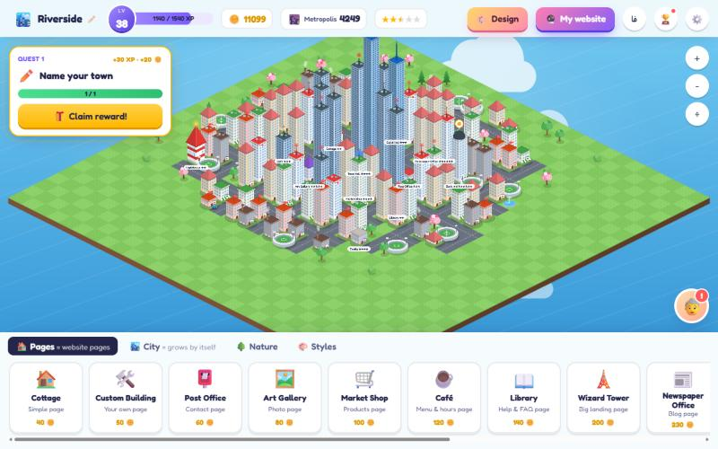
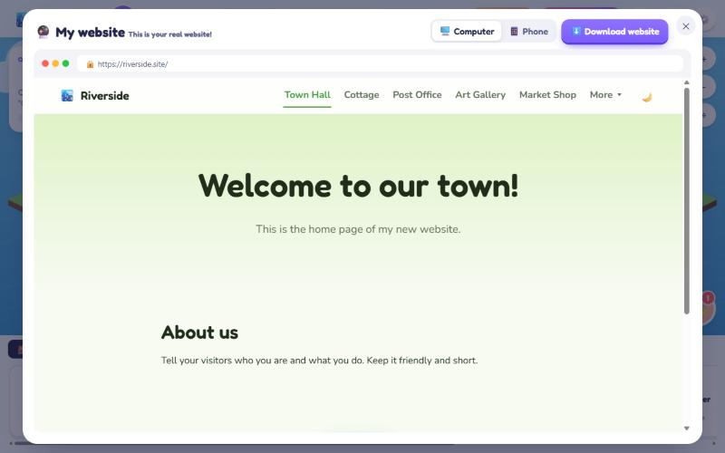

# Town Builder

Build a little town in your browser. When you're done, download it, and it's a real website.

[](../../actions/workflows/ci.yml)



I wanted a way for people who have never written code to make a website without staring at a page builder full of settings. So it's a game instead. Every building you put down is a page. Everything you put inside a building (a title, some text, a photo wall, a contact form) becomes a section of that page. Your town's name is your site's name.

You start with a village of two small houses and a town hall. If you keep playing, people move in, buildings grow a floor at a time, the roads turn into streets with cars on them, and one day you look at it and there are skyscrapers. Your website grows with it and picks up new extras along the way.

## How the game maps to a website

| In the game                      | On your website                                     |
| -------------------------------- | --------------------------------------------------- |
| Town name and logo               | Site name and logo                                  |
| A page building (Cottage, Café…) | One page. The Town Hall is the home page.           |
| Furniture inside it              | Parts of the page: titles, text, pictures, forms…   |
| Town style and the Design Studio | Colours, fonts, corners, spacing, animations        |
| Your town getting bigger         | New website extras (dark mode switch, progress bar) |
| 🔮 My website                    | Live preview, then download as a .zip               |



## Playing

You need [Node.js](https://nodejs.org) 20 or newer.

```bash
npm install
npm run dev
```

Then open http://localhost:5173. The first time, it asks which language you want and gives you a one-minute tour.

Your town is saved in the browser automatically, and it keeps growing a bit while you're away. If you want a copy you can move to another computer, use ⚙️ → **Save project file**.

## What's in it

**Two kinds of buildings.** Page buildings are your website: Town Hall, Cottage, Post Office (contact page), Art Gallery, Shop, Café, Library, Newspaper Office (blog), Cinema, Bank (pricing), and a few more. There's also a **Custom Building** where you pick the roof shape, the colours and the sign yourself, and it starts as a blank page.

City buildings (homes, shops, schools, offices, hospitals, factories, a stadium, a sky tower) don't become pages. They bring people and coins, and they grow taller on their own. Offices can reach 40 floors; the Sky Tower goes higher than anything else.

**Eras.** Population moves your town from Village to Town, City and finally Metropolis. Each era raises how tall buildings can get, how far you can upgrade your pages, and unlocks something new for your website.

**Upgrades.** Click any building to upgrade it. Page buildings go from ★1 to ★10. From ★3 up they turn into towers, and each upgrade gives the page room for more sections.

**Laying out the page.** Any section can take the full row, half, a third or two-thirds, so you can put things side by side. You can also line each one up at the start, middle or end, and move it up or down within its row.

**Styling.** Colours, gradients, background pictures, patterns, 18 fonts, title size, corners, shadows, borders, spacing, input box style, appear animations, the menu bar, and custom CSS if you know it. You can set these for the whole site, for one page, or for one section. The simple view only shows the basics; press **Show all design tools** when you want the rest.

**Forms.** Contact forms and custom forms with any inputs you like: text, email, phone, number, date, dropdowns, pick-one, tick boxes. Each one has a label, a hint and a required switch.

**Keeping you coming back.** Quests that walk you through everything, levels, badges, a daily gift with a streak, and treasure bubbles that pop up over your houses.

## English and Persian


The whole game is available in English and Persian (فارسی). In Persian, the interface flips to right-to-left, numbers are written in Persian digits, and it uses the Vazirmatn font.

The website direction is set separately from the game language. In the Design Studio you choose the site's language and whether it reads left-to-right or right-to-left. Each page, and each section on a page, can override that. So you can write a Persian site with one English section, or the other way round.

To add another language, copy `src/i18n/fa.ts`, translate the values, and register it in `src/i18n/index.ts`. A test lists any sentence you missed.

## What you get when you download

A .zip with plain HTML and CSS files, one per page, plus a `README.txt` that explains how to put it online for free. Any ordinary web host works too. No build step, no framework, and a script only gets added if something on the page actually needs one. Page titles and descriptions for Google are included.

## Working on the code

```bash
npm run check   # types, lint, formatting, tests and a production build (same as CI)
npm test        # just the tests
```

Every pull request runs `npm run check` on GitHub Actions, so if it passes locally it should pass there too.

- [docs/ARCHITECTURE.md](docs/ARCHITECTURE.md): how the code is organised and why
- [CONTRIBUTING.md](CONTRIBUTING.md): setup, code style, and how to add new buildings, furniture or translations

It's TypeScript and Vite, with no UI framework and no runtime dependencies. The map is a single canvas: buildings are drawn once as SVG and kept as GPU bitmaps, so even a full metropolis takes a few milliseconds per frame.
