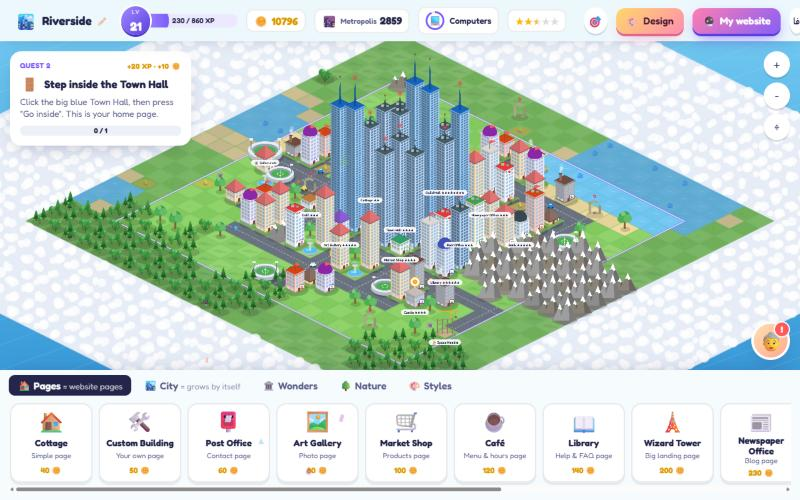
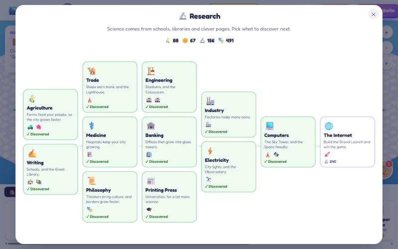
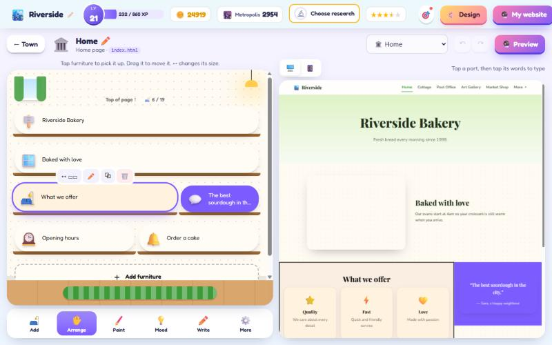
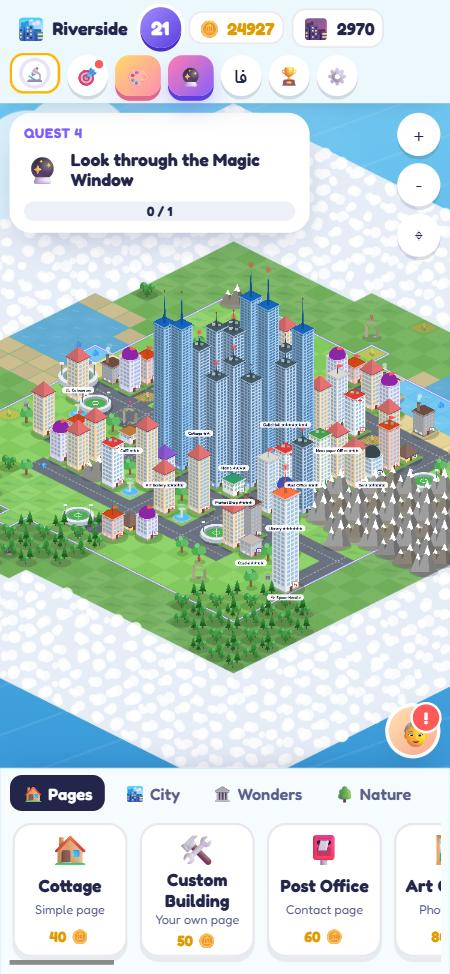
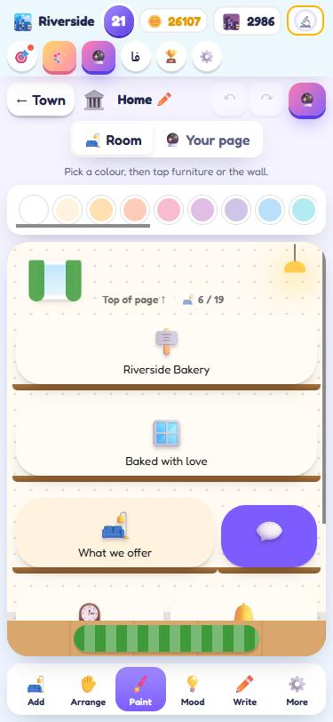
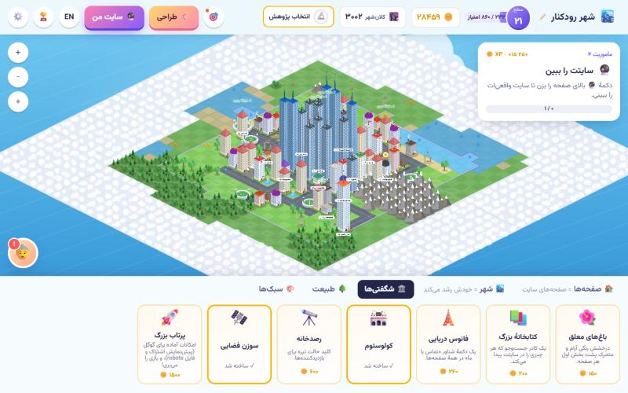

<div align="center">

# 🏙️ WebCity

### Build a city. Get a website.

A city-building game that runs in your browser. Every building you put down is a page,
every room you decorate is a part of that page, and when you win, you download a real website.

**[▶ Play it now](https://alirezasariri78.github.io/WebCity/)** · no install, works on your phone

[](https://github.com/alirezasariri78/WebCity/actions/workflows/ci.yml)
[](https://github.com/alirezasariri78/WebCity/actions/workflows/deploy.yml)




</div>

## Why this exists

Making a first website is boring in a very specific way: a page full of empty boxes, a sidebar full of settings, and no idea where to start.

I wanted it to feel like the strategy games I grew up with instead. You start with a village of three houses inside a small border. Fog covers the rest of the map. You claim land, research new technologies, build wonders, and slowly the village turns into a city with streets, cars and glass towers.

The trick is that the whole time, you were building a website. The Town Hall is your home page. The café is your menu page. The post office is your contact form. When you finally build the last wonder, the game ends with your site packed in a zip, ready to put online.

## How it plays

**You start small.** A Town Hall, two homes and a tight border. Everything else is hidden under clouds.

**You grow outwards.** Tap land next to your border to buy it, or let culture push the border out by itself. Behind the fog are lakes, forests, mountains, gold, wheat fields and ancient ruins with surprises inside.

**You discover things.** Schools, libraries and good pages make science. Science unlocks a technology tree: Agriculture, Writing, Trade, Medicine, all the way to Computers and The Internet. Each one brings new buildings.

**You build wonders.** Each wonder takes a few real minutes to build and gives your website a new ability:

| Wonder             | Your website gets                                |
| ------------------ | ------------------------------------------------ |
| 🌺 Hanging Gardens | a soft glow behind the banner                    |
| 📚 Great Library   | search across every page                         |
| 🗼 Lighthouse      | a floating "Contact us" button                   |
| 🏟️ Colosseum       | tap any picture to see it big                    |
| 🔭 Observatory     | a dark mode switch                               |
| 🛰️ Space Needle    | install it on a phone, like an app               |
| 🚀 Grand Launch    | share previews, robots.txt, sitemap, and you win |

**The city grows while you are away.** Homes add floors, the population moves you from Village to Town to City to Metropolis, and every era lets buildings reach higher.

**There is always something to do today.** Three daily challenges, a daily gift with a streak, quests that teach you one thing at a time, and a Golden Age when you finish all three challenges.



## Decorating is designing

Step inside any building and you are in a room, not a form.



- **Add furniture** and it becomes a part of the page. A sign is a title, a bookshelf is a list, a painting is a picture, a mailbox is a contact form.
- **Drag furniture around** to change the order. Tap ↔ to make it full width, half, or a third, so things sit side by side.
- **Grab the paint brush**, pick a colour and tap a piece of furniture. That part of the page changes colour. Tap the wall and the whole page does.
- **Change the mood**: lights for a light or dark page, wallpaper for the background pattern, a round or square rug for the corners, and lettering for the font.
- **Write on the page itself.** Tap a part, then tap its words and type. No forms to fill in.

Everything you do in the room shows up on the real page next to it, right away.

## On your phone

Most people will open this on a phone, so it is built for that first: one-thumb controls, a tool dock at the bottom, pinch to zoom, and the room and the page take turns on the screen.

<p align="center">
  
  &nbsp;&nbsp;
  
</p>

## English and فارسی



The whole game is in English and Persian. In Persian everything flips right to left, numbers use Persian digits, and text uses the Vazirmatn font.

Your website has its own language setting, separate from the game. Each page, and each part of a page, can be left to right or right to left, so a Persian site with one English section works fine.

## What you get at the end

A zip with one plain HTML file per page and one stylesheet. No framework, no build step. A script is only added when something on the page actually needs one. Drop the folder on Netlify, GitHub Pages or any web host and it is live.

## Run it yourself

You need [Node.js](https://nodejs.org) 20 or newer.

```bash
git clone https://github.com/alirezasariri78/WebCity.git
cd WebCity
npm install
npm run dev
```

Open http://localhost:5173. Your progress saves in the browser by itself.

To host your own copy for free: fork the repo, open **Settings → Pages**, set **Source** to **GitHub Actions**, and push. The included workflow builds and publishes it.

## Under the hood

- TypeScript in strict mode, Vite, and zero runtime dependencies.
- The map is one `<canvas>`. Buildings, trees and cars are drawn once as SVG and kept as GPU bitmaps, and the ground is painted in 8×8 tile chunks that only redraw when something changes. A full metropolis draws in a few milliseconds per frame.
- The world is generated from a seed, so a save file only stores what you changed.
- The game rules and the website generator are plain functions with no DOM, which makes them easy to test. There are 300+ tests, and every pull request runs type checks, lint, formatting, tests with coverage and a production build.

More detail in [docs/ARCHITECTURE.md](docs/ARCHITECTURE.md). Want to add a building, a piece of furniture or a language? [CONTRIBUTING.md](CONTRIBUTING.md) walks you through it.

## Say hi

If WebCity made you smile, a ⭐ on the repo helps other people find it. Ideas, bug reports and pull requests are all welcome.

## License

MIT. See [LICENSE](LICENSE).
